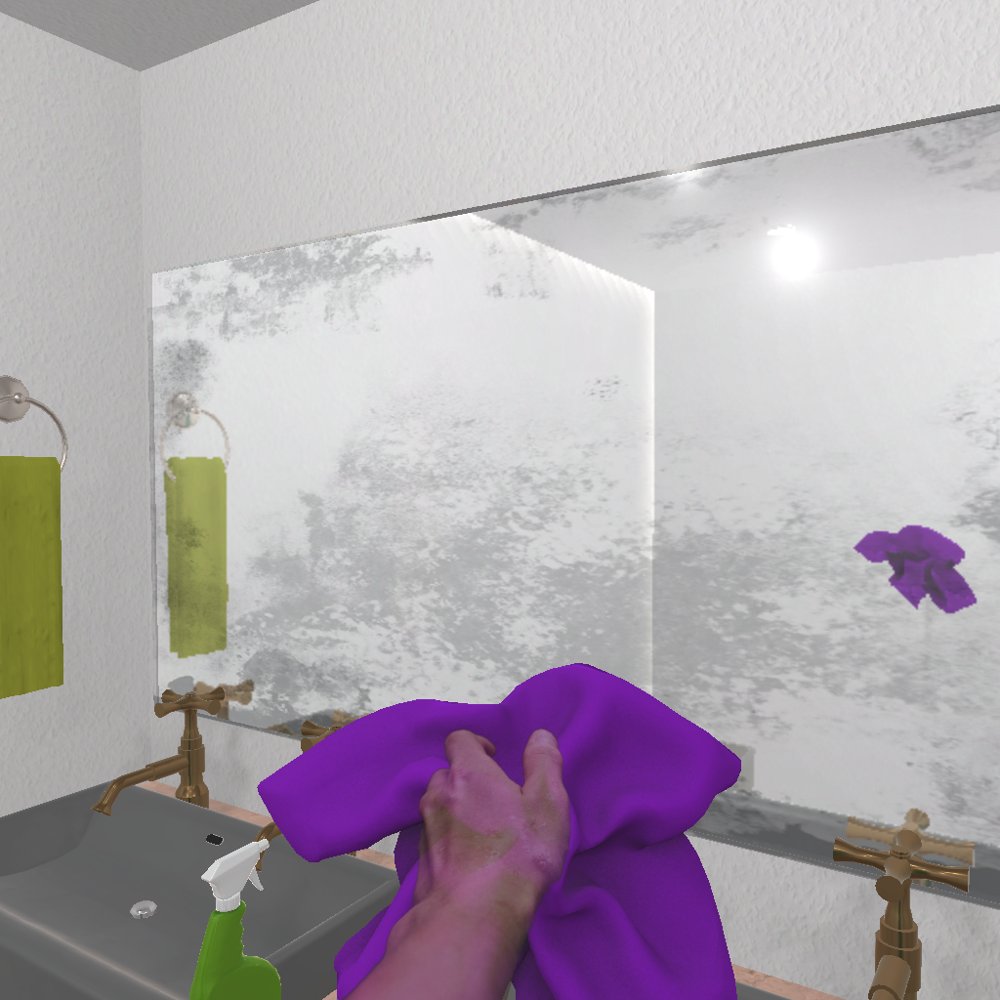
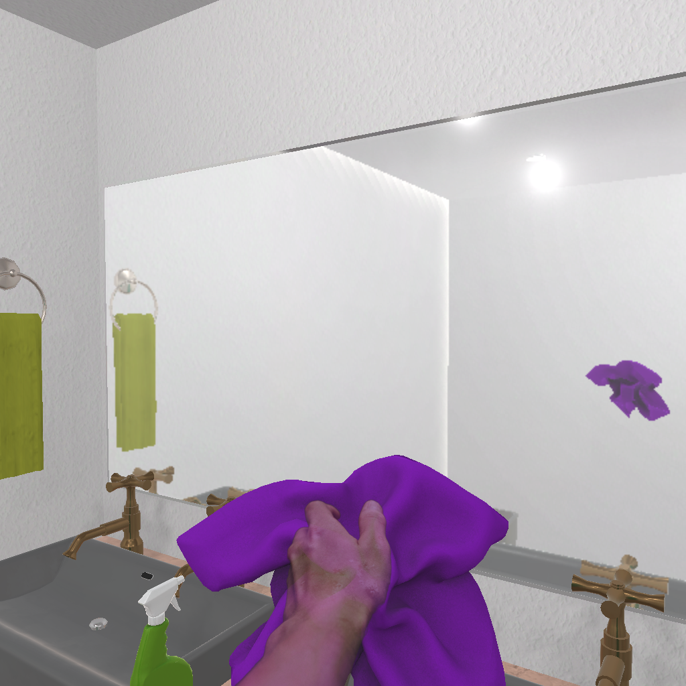
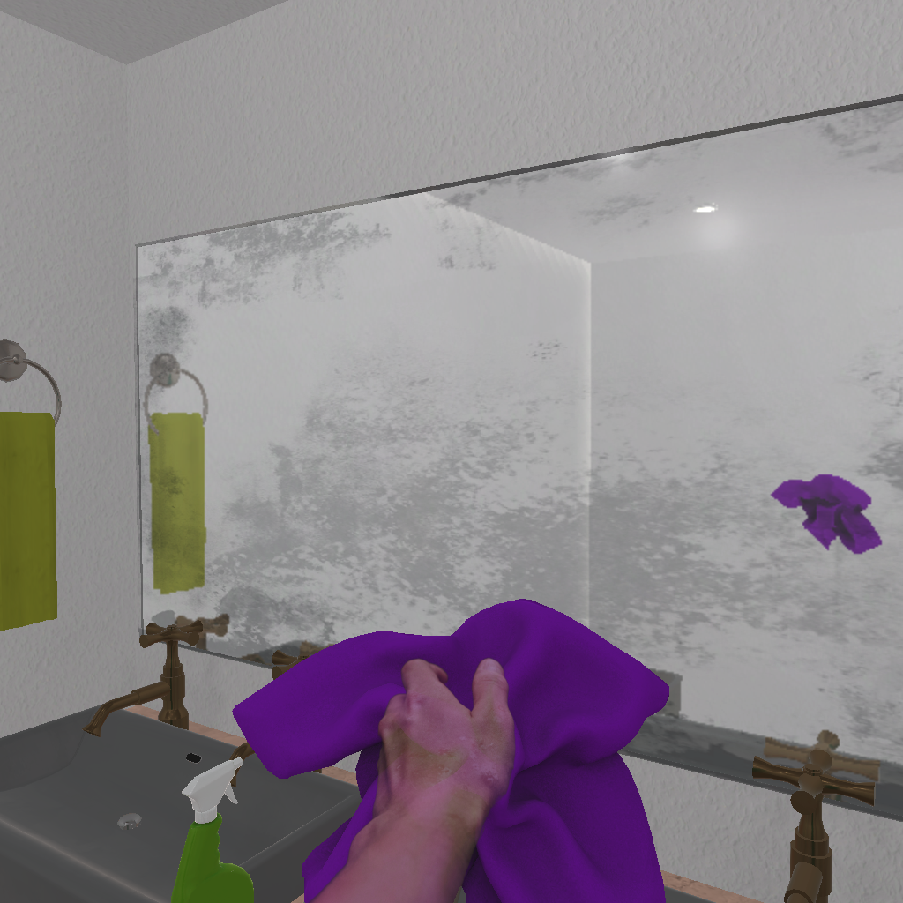

# CausalPilot-Bench

**See the state. Choose the action. Stay consistent under visual change.**

CausalPilot-Bench brings matched visual interventions to embodied next-action
evaluation. A dirty mirror becomes clean. A closed container opens. A device
switches on. The task stays fixed, and the next action follows the current state.

**95 causal-state units · 12,861 triplets · 38,583 images · 7 predicates · 48 scenes**

[Explore the data](data/) · [Quick start](#quick-start) ·
[Benchmark design](docs/paper_alignment.md) · [Build extensions](docs/construction.md)

## One checkpoint, three observations

Each matched triplet isolates two complementary abilities: responding to a
decision-critical state change and preserving the decision under nuisance.
The instruction, completed history, and legal action interface stay fixed.

| Anchor | Causal | Nuisance |
| --- | --- | --- |
|  |  |  |
| Visible dirt → `clean Mirror` | Clean surface → `done none` | Changed lighting, same dirt → `clean Mirror` |

This structure supports causal response, nuisance invariance, and joint grounding
metrics. During inference, each observation is presented independently.

## Two collections, one consistent interface

| Collection | Causal-state units | Triplets | Images | Predicate types |
| --- | ---: | ---: | ---: | ---: |
| [Curated core (`paper`)](data/paper/) | 71 | 996 | 2,988 | 4 |
| [Expanded collection (`extended`)](data/extended/) | 95 | 11,865 | 35,595 | 7 |

The core combines exact state-control checks with agent visual curation of every
selected triplet. The expanded collection adds predicate coverage and a broad
stress suite: **20 nuisance families × 6 severities × 92 source units**, producing
11,040 additional triplets with recorded parameters, seeds, and source hashes.
Stress variants inherit source action labels and carry explicit review status.

Triplet IDs are disjoint across collections. Shared source units keep the full
release at **95 unique causal-state units**; render replicas remain clustered
with their source. The [dataset card](docs/dataset_card.md) documents collection
scope, evidence contracts, and review provenance.

## Seven predicates across five semantic aspects

| Aspect | Predicates | Decision focus |
| --- | --- | --- |
| Cleaning | `isDirty` | Whether cleaning is still needed |
| Access | `isOpen` | Container access and opening or closing |
| Device control | `isToggled` | Activation state |
| Food preparation | `isCooked`, `isSliced` | Processing status |
| Liquid and consumables | `isFilledWithLiquid`, `isUsedUp` | Contents and availability |

Browse each collection by semantic aspect, predicate, and FloorPlan. Collection
catalogs, a shared unit index, and per-record provenance support precise subsets.

## Quick start

```bash
uv sync
```

```python
from construction.load import iter_triplets, observation_input

for triplet in iter_triplets("data", collection="paper"):
    sample = observation_input(triplet, "anchor", "data")
    # Send the fixed context and image bytes to your model adapter.

# Include all seven predicates, including the trace-derived consumable layer.
expanded = iter_triplets("data", collection="extended", metadata_only=False)
```

The reader filters by collection, predicate, scene, and release partition.
`observation_input` returns fixed context and one image while withholding
reference labels and intervention identity. The default `metadata_only=True`
excludes trace-derived consumable records and their descendants.

## Release contents

```text
data/
  paper/                # Curated core catalogs and classified manifests
  extended/             # Expanded catalogs, manifests, and stress images
  review/               # Per-triplet curation annotations and asset bindings
  scenarios/            # Shared source images and classified source records
  catalog.json          # Complete release entry point
  counts.json           # Exact collection, predicate, and profile counts
  unit_index.json       # Source units and collection membership
  benchmark.json        # Preserved 996-triplet reference archive
  causal_states.json    # Preserved 71-unit reference archive
simulation/             # Raw metadata, state snapshots, and reconstruction recipes
construction/           # Readers, reconstruction, and expansion tools
checksums.json          # SHA-256 integrity manifest
```

All observation paths resolve relative to the top-level `data/` directory.
Shared assets are referenced directly by both collection catalogs.

[Dataset card](docs/dataset_card.md) · [Schema and metrics](docs/schema.md) ·
[Construction guide](docs/construction.md) · [Curation protocol](data/review/)

Construction tools derive from [Microsoft AsgardBench](https://github.com/microsoft/AsgardBench)
and retain the MIT [license](LICENSE). Simulator assets and rendered content are
subject to their upstream terms. This release includes benchmark data,
construction tools, and provenance; evaluation programs and model results are
outside its scope.
